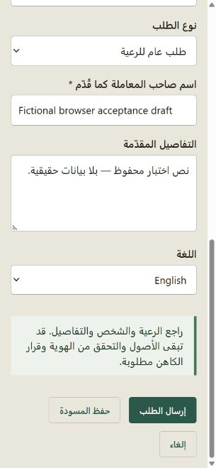

# Implementation verification

**Status: substantial core implementation; complete requested scope remains unfinished. Do not treat this branch as an accepted release.** No complete A01–A30 scenario is certified passed. The [question checklist](checklist.md), [scenario review](scenario-review.md) and [machine inventory](traceability.json) distinguish actual code/tests from remaining software and real-world dependencies.

## Baseline and preservation

- Confirmed fetch/push remote: `https://github.com/georges33tawk24/parishlife.git`.
- Fetched GitHub `main` before implementation and again on 29 October 2026. Both resolved to `4ec733bfe56f690b645e0c388c4c5f87e48bbd37`.
- Implemented on `codex/reviewed-requirements` in a dedicated managed worktree, based directly on that commit. Main's actual architecture is ASP.NET Core .NET 10 Razor Pages/EF SQLite; no colin application code was merged or copied.
- The original colin checkout retains its untracked `docs/ux-discovery/` and `output/`; its tracked application files remain untouched. Source documentation was copied separately for provenance.
- All four primary reviewed snapshots still match the supplied Desktop files byte-for-byte. [Source hashes](requirements-sources.json). `.gitattributes` preserves source snapshot bytes across checkout platforms.
- Main was inspected in the browser before replacement: limited reservation/events/people/notices functionality, inert context switch, no French interface and no complete reviewed operations implementation. Baseline tests were 35 passed, 2 failed due to fixed event dates now in the past. Date fixtures now use real future occurrences and assert reservation/waitlist outcomes.

## Executed checks

| Check | Actual result |
| --- | --- |
| `dotnet test ParishLive.slnx --configuration Release --no-restore --logger "trx;LogFileName=reviewed-release.trx"` | **64 passed, 0 failed, 0 skipped** on 29 October 2026 |
| Build as part of that Release test | 0 errors; 3 CS9113 warnings for unused constructor dependencies |
| `dotnet ef migrations has-pending-model-changes --project src/ParishLive.Infrastructure --startup-project src/ParishLive.Web --configuration Release --no-build` | No model changes missing a migration |
| `dotnet list ParishLive.slnx package --vulnerable --include-transitive` | NuGet reported no known vulnerable packages for all five projects at check time; not a comprehensive security audit |
| `node tools/check-localization.mjs` | Literal Razor UI and `Error.*` keys present in EN/FR/AR; does not establish all dynamic strings, legacy content or Identity Manage localization |
| `node tools/check-implementation.mjs` | 436 exact question criteria, 30 scenario entries, existing referenced code/tests and unchanged primary reviewed sources |
| Bundled Python `docs/ux-discovery/reviewed-answers/check_pack.py` | PASS: 436 questions, 32 sections, 30 scenarios, 65 workflows/forms, 878 field bindings, 553 documented transitions and 5,880 local links |
| `git diff --check` | No whitespace errors |

The original documentation checker verifies documentation integrity only. It does not prove that 553 transitions have been implemented. Its original absolute-source-path checks require the original local files; the portable implementation checker uses committed relative snapshots. [Recorded test counters](verification-results.json). Raw TRX files are generated under ignored `tests/ParishLive.IntegrationTests/TestResults/`.

## Meaningful automated coverage

- Live acting assignment, tenant/org isolation, wrong-parish priest rejection, secretary versus preparation-admin authority, role expiry/revocation and actual independent users.
- Genuine prior priest instruction is effective once; history retains recorder and priest. The proposed certificate-stage extension is separately gated and still cannot substitute for the priest's personal signature.
- Actor/payload-bound idempotent requests, replayed outcomes, changed-payload rejection, stale versions and immutable official/posted/history records through both SaveChanges overloads.
- Unlinked authenticated requester creates/resumes a server draft and replaces rejected evidence without seeing another request. Guest retry preserves one case; reviewed account association revokes the old token without granting membership.
- Wrong-source final files, bishop return invalidating signature/file, distinct actual re-sign/review, exact recipient download and withdrawal blocking future access.
- Anonymous sensitive concerns exclude ordinary administrators from contents and counts. Identity permission remains separate, conflicted access stops and private pastoral notes are not inherited by another priest or administrator.
- **Two independent SQLite connections** compete for the last event place: one Reserved and one Waitlisted. Unknown age/consent blocks confirmation; an unauthorized collector creates no exit.
- Original USD/LBP precision, separate actual balances, bounded allocations, independent approval, count variance/exact revision/close once, closed-line locking, internal allowance transfer and one consolidated purchase expense.
- Financial viewer export remains scoped, escapes spreadsheet formulas and does not enable direct writes. Notices honor audience restrictions through service and HTTP API.
- Valid parish setup without secretary, delegated diocesan authority, appointment acceptance and scoped revocation preserving another parish appointment.
- **Populated main migration test**, not only fresh schema/seed: existing appointments stay effective, existing venue availability survives, parishes stay private and no retrospective consent/policy approval is fabricated.
- Priest direct reservation approval needs no secretary step; setup/cleanup intervals block a competing booking.

## Browser observations

Local demonstration data only; no actual parish information or external integration was used.

1. Opened the combined Home and current priest scope after upgrading a populated main development database.
2. Entered a fictional English request with Arabic details. Changing language displayed Save draft / Discard / Stay. Save completed, navigated to the same persisted draft in Arabic, and retained its supplied text. Switching to French retained the same reference and Arabic facts.
3. Checked Arabic desktop layout and narrow-phone layout, including visible navigation labels, correctly directed input, required fields and reachable save/submit controls. The requested phone viewport was 390×844; the browser reported an effective CSS width of approximately 305px in this desktop host. That is evidence for this host, not a physical-device certification.
4. Corrected two real browser findings: baseline compact navigation hid the new text-only link names; initial generated migrations disabled existing appointments. Both fixes were followed by verification, including the populated-main regression test.
5. Browser console check returned no captured warning/error entries for the inspected draft flow. Viewport override was reset.

[Arabic desktop](screenshots/arabic-desktop-draft.jpg) · [French desktop](screenshots/french-desktop-draft.jpg).

No actual keyboard-only/screen-reader user, physical phone/tablet, real printer, contrast/zoom audit, signed religious specimen, independent safeguarding exercise or real money reconciliation has been approved. Session-expiry/file-preservation and all thirty complete cross-role browser scenarios remain open.

## Remaining dependencies and software

U01–U15 in the reviewed pack still require actual names/contacts/appointments, religious requirements/rite/numbering, guardian/assisted-age rules, allowed proxy stages, templates/signature/bishop policy, financial terms/openings, safeguarding/independent routing, retention, schedules/media, delivery/verification/workers, import volumes, bundles/sponsorship, departed notebooks, named language/device reviewers and operator backup/restore evidence.

These inputs do **not** account for all remaining work. Missing application software includes the full forms and field dictionary, household/merge/import workflows, official amendments, shared clergy/resource scheduling, service plans/music, meeting attendance/loans, volunteer rotas, transport/fees/material event changes, equipment/maintenance, post-close giving reclassification/statements, finance reconciliation/period close, Inbox/prayers, full independent concern reassignment, workflow builder, bundle downgrades and retention/data-request workflows. See every section's explicit remaining list. Unused storage entities and unavailable labels do not count as working modules.

## Delivery and migration limits

The branch targets a **draft PR to main**. GitHub CI is defined separately; local passing checks do not imply a remote Actions run passed. Main has not been merged and no production migration/deployment has run. Explicit user approval remains required before either merge or deployment.

Development/testing applies migrations to local demonstration/test databases. Other environments require reviewed migration application through an explicit configuration path. New policy gates default unavailable. The main-data normalization migration only enables legacy revision-zero appointments/resources; it does not reactivate a later revoked appointment. Existing event consent is marked `legacy-unreviewed`. Actual data backup, restore rehearsal and jurisdiction/domain acceptance remain required before a future approved rollout.
